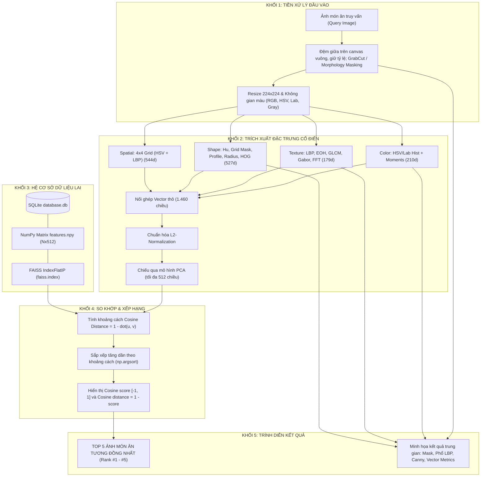

# BÁO CÁO ĐỒ ÁN MÔN HỌC: CƠ SỞ DỮ LIỆU ĐA PHƯƠNG TIỆN
## ĐỀ TÀI: XÂY DỰNG HỆ CSDL LƯU TRỮ VÀ TÌM KIẾM ẢNH MÓN ĂN DỰA TRÊN NỘI DUNG (CBIR)

---

## MỤC LỤC
1. [PHẦN 1: MÔ TẢ ĐẶC ĐIỂM GIỐNG VÀ KHÁC NHAU CỦA BỘ DỮ LIỆU](#phần-1-mô-tả-đặc-điểm-giống-và-khác-nhau-của-bộ-dữ-liệu)
   - 1.1. Tổng quan bộ dữ liệu ảnh thu thập
   - 1.2. Bảng tổng quát đặc điểm giống và khác nhau của bộ dữ liệu (6 nhóm đặc trưng)
   - 1.3. Phân tích giá trị thông tin đối với bài toán tìm kiếm tương đồng
2. [PHẦN 2: XÂY DỰNG CÁC BỘ THUỘC TÍNH NHẬN DIỆN MÓN ĂN (1.460 CHIỀU &rarr; PCA tối đa 512 CHIỀU)](#phần-2-xây-dựng-các-bộ-thuộc-tính-nhận-diện-món-ăn-1460-chiều--pca-tối-đa-512-chiều)
   - 2.1. Đặc trưng Màu sắc (Color Features - 210 chiều)
   - 2.2. Đặc trưng Kết cấu bề mặt (Texture Features - 179 chiều)
   - 2.3. Đặc trưng Hình dạng & Đường biên (Shape Features - 527 chiều)
   - 2.4. Đặc trưng Bố cục không gian (Spatial Layout Features - 544 chiều)
   - 2.5. Cơ chế Chuẩn hóa L2 và Giảm chiều tuyến tính PCA (1.460D &rarr; tối đa 512D)
3. [PHẦN 3: THUẬT TOÁN TRÍCH RÚT ĐẶC TRƯNG VÀ HỆ CƠ SỞ DỮ LIỆU LAI (HYBRID DATABASE)](#phần-3-thuật-toán-trích-rút-đặc-trưng-và-hệ-cơ-sở-dữ-liệu-lai-hybrid-database)
   - 3.1. Các thuật toán trích rút và lý do kỹ thuật lựa chọn
   - 3.2. Tiền xử lý & Tách vùng đối tượng món ăn (GrabCut Segmentation & Morphology)
   - 3.3. Thiết kế Kiến trúc Cơ sở dữ liệu lai (SQLite + NumPy + FAISS + CSV)
4. [PHẦN 4: HỆ THỐNG TÌM KIẾM ẢNH TƯƠNG ĐỒNG (CBIR ENGINE) & ĐÁNH GIÁ](#phần-4-hệ-thống-tìm-kiếm-ảnh-tương-đồng-cbir-engine--đánh-giá)
   - 4.1. Sơ đồ khối hệ thống (System Block Diagram)
   - 4.2. Chức năng từng khối và luồng dữ liệu Vào/Ra (I/O)
   - 4.3. Mô tả quy trình thực hiện yêu cầu đề tài
   - 4.4. Minh họa các kết quả trung gian trong quá trình truy vấn
   - 4.5. Đánh giá các kết quả đạt được (Khoảng cách Cosine & Hiệu năng truy vấn)
5. [PHẦN 5: DEMO HỆ THỐNG TRÊN NỀN TẢNG WEB (FLASK APPLICATION)](#phần-5-demo-hệ-thống-trên-nền-tảng-web-flask-application)
   - 5.1. Thiết kế và tổ chức giao diện ứng dụng Web (`app.py`)
   - 5.2. Tối ưu hóa và đo lường hiệu năng
   - 5.3. Hướng dẫn chi tiết cài đặt và vận hành hệ thống

---

# PHẦN 1: MÔ TẢ ĐẶC ĐIỂM GIỐNG VÀ KHÁC NHAU CỦA BỘ DỮ LIỆU

### 1.1. Tổng quan bộ dữ liệu ảnh thu thập
- **Quy mô dữ liệu ban đầu:** Bộ dữ liệu gốc trong lần đánh giá ban đầu gồm **564 tệp ảnh** thuộc **110 danh mục**. Ảnh upload được bổ sung vào `data/uploads/`, vì vậy số lượng ảnh trong chỉ mục có thể tăng sau mỗi lần sử dụng.
- **Định dạng lưu trữ:** `.jpg` (chuẩn màu RGB 24-bit).
- **Kích thước ảnh upload:** Máy chủ giữ nguyên tỷ lệ bằng cách căn giữa ảnh trên canvas vuông, bù phần thiếu bằng màu trung vị viền ảnh, rồi resize thành $512 \times 512$. Khi trích đặc trưng, ảnh nguồn không vuông cũng được đệm tương tự trước khi resize về $224 \times 224$.
- **Quy cách chụp:** Chụp thẳng từ trên xuống (**Top-Down View / góc chụp 90°**).
- **Vật chứa & Bố cục:** Món ăn được đựng trong đĩa tròn, khay hoặc bát/tô tròn, nằm căn giữa trọng tâm bức ảnh. Tỉ lệ khung hình và kích thước vùng món ăn chiếm từ $75\% - 90\%$ diện tích ảnh.

---

### 1.2. Bảng tổng quát đặc điểm giống và khác nhau của bộ dữ liệu

Dưới đây là **Bảng tổng quát đặc điểm giống và khác nhau của bộ dữ liệu** theo 6 nhóm đặc trưng thị giác cốt lõi:

| Nhóm đặc trưng | Đặc điểm giống nhau | Đặc điểm khác nhau | Giá trị đối với tìm kiếm |
|:---|:---|:---|:---:|
| **Màu sắc (Color)** | Các món ăn đều được cấu thành từ các gam màu tự nhiên của thực phẩm tươi sống hoặc đã qua chế biến (đỏ cà chua/ớt, xanh rau thơm, vàng sợi mì/trứng, trắng cơm/phở, nâu thịt kho). | - Gam màu chủ đạo khác biệt theo từng trường phái ẩm thực (canh rau thiên về dải màu xanh lục, súp bí đỏ/bún riêu thiên về dải màu cam đỏ, phở gà thiên về màu trắng ngà và nước trong).<br>- Độ bão hòa màu và độ tương phản giữa nước xốt và nguyên liệu đệm khác nhau rõ rệt. | **Rất cao** |
| **Hình dạng (Shape)** | Đều có đường bao tổng thể bên ngoài theo hình dáng vật chứa (chủ yếu là đĩa tròn, tô tròn, bát hình khuyên đối xứng tâm). | - Hình dạng chi tiết của từng khối nguyên liệu bên trong rất đa dạng: dạng sợi dài uốn lượn (bún, miến), khối vuông (đậu phụ chiên, thịt kho tàu), lát cắt tròn (chả lụa), hình giọt nước/tròn (trứng cút, bánh bao), hoặc mảnh vụn li ti (cơm chiên). | **Cao** *(sau khi đã phân đoạn đối tượng tách nền đĩa)* |
| **Kết cấu (Texture)** | Bề mặt đều được tạo thành từ các lớp vật liệu hữu cơ không đồng nhất (không phải bề mặt kim loại hay nhân tạo nhẵn bóng tuyệt đối). | - Tính chất bề mặt thể hiện sự tương phản sâu sắc: bề mặt phẳng mịn (chất lỏng nước dùng, bánh flan), bề mặt nhăn gồ ghề (gà rán chiên xù, bánh phồng tôm), bề mặt dạng sợi đan xen phức tạp (bún chả, hủ tiếu), bề mặt dạng hạt rời rạc (cơm tấm, mè rang). | **Rất cao** |
| **Thành phần (Constituents)** | Đều là sự kết hợp đa thành phần giữa tinh bột (gạo, bột mì), chất đạm (thịt cá, trứng), chất xơ (rau củ) và chất liên kết (nước xốt, dầu mỡ). | - Số lượng và loại nguyên liệu thành phần khác nhau: món đơn thành phần (cơm trắng, canh suông) so với món đa thành phần phối trộn phức tạp (lẩu thập cẩm, bún đậu mắm tôm 7 món). | **Rất cao** |
| **Bố cục (Layout)** | Món ăn luôn nằm tập trung ở khu vực trung tâm bức ảnh ($[0.15, 0.85]$ theo cả hai chiều $X, Y$), bao quanh bởi viền đĩa hoặc mặt bàn. | - Cách thức bày biện món ăn: xếp tròn đối xứng nan quạt (đĩa lẩu, gỏi cuốn), xếp tầng chồng lớp (bún mọc, phở), trộn lẫn ngẫu nhiên (nộm gỏi, cơm chiên Dương Châu), hoặc đặt một khối nguyên liệu lớn ở trung tâm (cơm sườn nướng). | **Cao** |
| **Kích thước (Size)** | Ảnh upload được đệm giữ tỷ lệ và chuẩn hóa về $512 \times 512$ px; vùng món ăn vẫn có thể chiếm tỷ lệ khác nhau giữa các ảnh. | - Kích thước tương đối giữa các hạt/khối nguyên liệu bên trong so với toàn bộ lòng đĩa (ví dụ: hạt cơm chỉ chiếm $<0.5\%$ diện tích đĩa, trong khi miếng sườn nướng chiếm $>40\%$ diện tích đĩa). | **Trung bình** |

---

### 1.3. Phân tích giá trị thông tin đối với bài toán tìm kiếm tương đồng
1. **Tính tương đồng nội lớp (Intra-class similarity):**
   - Các ảnh chụp cùng một loại món ăn (ví dụ: các ảnh của *Phở bò*) có sự nhất quán cao về gam màu chủ đạo (nước dùng vàng nâu mỡ bò, sợi phở trắng ngà, hành hoa xanh), kết cấu vi mô (sợi phở đan xen) và bố cục đặt trong tô tròn.
2. **Tính phân biệt liên lớp (Inter-class dissimilarity):**
   - Sự khác biệt về thành phần và kết cấu là chìa khóa để phân loại các món khác nhau: *Bún đậu mắm tôm* (đĩa mẹt tre phẳng, các khối đậu chiên vàng xếp rời cạnh bún lá trắng và chả cốm) hoàn toàn khác biệt với *Canh bí đỏ* (tô sâu lòng, chất lỏng màu cam đỏ đồng nhất).

---

# PHẦN 2: XÂY DỰNG CÁC BỘ THUỘC TÍNH NHẬN DIỆN MÓN ĂN (1.460 CHIỀU &rarr; PCA tối đa 512 CHIỀU)

Hệ thống xây dựng mô hình trích xuất đặc trưng thuần túy dựa trên **Thị giác máy tính cổ điển (Classical Computer Vision - No Deep Learning)**, bao gồm **4 bộ thuộc tính** với tổng cộng **1.460 chiều đặc trưng thô**, sau đó áp dụng **Chuẩn hóa $L_2$** và **PCA** với số chiều tối đa 512. Số chiều thực tế là $k = \min(512, N, 1460)$, trong đó $N$ là số ảnh hợp lệ dùng huấn luyện:

```
                 KIẾN TRÚC BỘ ĐẶC TRƯNG THỊ GIÁC CỔ ĐIỂN (1.460 CHIỀU)
  ┌───────────────────┬───────────────────┬───────────────────┬───────────────────┐
  │   1. COLOR (210)  │  2. TEXTURE (179) │   3. SHAPE (527)  │  4. SPATIAL (544) │
  ├───────────────────┼───────────────────┼───────────────────┼───────────────────┤
  │ - HSV Hist: 96    │ - Unif LBP: 10    │ - Hu+Scalars: 11  │ - 4x4 Grid Cells  │
  │ - Lab Hist: 96    │ - EOH: 9          │ - Grid Mask: 64   │   x (24 HSV +     │
  │ - Moments: 18     │ - GLCM: 16        │ - Contour Prof: 64│      10 LBP)      │
  │   (Mean/Std/Skew) │ - Gabor Bank: 80  │ - Radius Sign: 64 │   = 16 x 34       │
  │                   │ - Stripe-FFT: 64  │ - HOG ROI: 324    │   = 544           │
  └───────────────────┴───────────────────┴───────────────────┴───────────────────┘
                                          │
                               [L2-NORMALIZATION]
                                          │
                             [PCA DIMENSION REDUCTION]
                           1.460 Chiều ────► 512 Chiều
```

---

### 2.1. Đặc trưng Màu sắc (Color Features - 210 chiều)
Màu sắc là tín hiệu thị giác cơ bản và quan trọng bậc nhất đối với bài toán nhận diện món ăn. Hệ thống trích xuất 210 chiều kết hợp đa không gian màu:
1. **Global HSV Histogram (96 chiều):**
   - Chuyển đổi ảnh sang không gian màu HSV (Hue - Saturation - Value).
   - Tách biệt rõ nét giữa sắc thái màu (Hue) và cường độ ánh sáng (Value).
   - Lập histogram độc lập: 32 bin cho kênh $H$, 32 bin cho kênh $S$, 32 bin cho kênh $V$.
   - Tổng cộng: $32 + 32 + 32 = \mathbf{96}$ **chiều**.
2. **Global CIE-Lab Histogram (96 chiều):**
   - Chuyển đổi ảnh sang không gian màu $L^*a^*b^*$, là không gian màu đồng đều tri giác (Perceptually Uniform).
   - Kênh $L^*$ đại diện cho độ sáng ($0 \div 100$), kênh $a^*$ biểu diễn trục Xanh lục &ndash; Đỏ, kênh $b^*$ biểu diễn trục Xanh lam &ndash; Vàng.
   - Lập histogram 32 bin trên từng kênh: $32 + 32 + 32 = \mathbf{96}$ **chiều**.
3. **Color Moments (18 chiều):**
   - Tính 3 mô-men thống kê phân bố: Giá trị trung bình (**Mean** $\mu$), Độ lệch chuẩn (**Standard Deviation** $\sigma$), và Độ xiên lệch phân bố (**Skewness** $s$).
   - Áp dụng trên cả 6 kênh màu ($H, S, V, L, a, b$): $6 \text{ kênh} \times 3 \text{ moments} = \mathbf{18}$ **chiều**.
- **Tổng số chiều nhóm Màu sắc:** $96 + 96 + 18 = \mathbf{210}$ **chiều**.

---

### 2.2. Đặc trưng Kết cấu bề mặt (Texture Features - 179 chiều)
Phản ánh mức độ thô nhám, vi cấu trúc hạt, sợi đan xen và tính lặp lại chu kỳ của bề mặt thực phẩm:
1. **Uniform Local Binary Pattern (LBP - 10 chiều):**
   - Sử dụng lân cận bán kính $R=1$ với $P=8$ điểm lấy mẫu.
   - Mẫu nhị phân đồng nhất (Uniform pattern) có số lần chuyển đổi bit $\le 2$. Gồm 9 mẫu cơ sở và 1 bin cho tất cả các mẫu không đồng nhất.
   - Số chiều: $\mathbf{10}$ **chiều**.
2. **Edge Orientation Histogram (EOH - 9 chiều):**
   - Dùng toán tử Sobel tính gradient ngang $G_x$ và dọc $G_y$.
   - Tính góc hướng gradient $\theta = \arctan(G_y, G_x) \in [0, \pi)$.
   - Lập histogram 9 bin ($20^\circ$/bin) với trọng số là độ lớn gradient: $\mathbf{9}$ **chiều**.
3. **Gray-Level Co-occurrence Matrix (GLCM Haralick - 16 chiều):**
   - Tính ma trận đồng xuất hiện mức xám với khoảng cách $d=1$ tại 4 góc hướng $\theta \in \{0^\circ, 45^\circ, 90^\circ, 135^\circ\}$.
   - Trích xuất 4 chỉ số thống kê Haralick trên từng góc: Contrast (Độ tương phản), Dissimilarity (Độ phân dị), Homogeneity (Độ đồng nhất), Energy (Năng lượng).
   - Số chiều: $4 \text{ hướng} \times 4 \text{ chỉ số} = \mathbf{16}$ **chiều**.
4. **Gabor Filter Bank (80 chiều):**
   - Bộ lọc Gabor mô phỏng phản ứng của các tế bào vỏ não thị giác đơn giản.
   - Thiết lập gồm 5 tần số bước sóng ($\lambda \in \{0.05, 0.1, 0.15, 0.2, 0.25\}$) kết hợp với 8 hướng góc ($\theta = k \cdot \frac{\pi}{8}, k=0 \dots 7$).
   - Tại mỗi ảnh lọc (40 bộ lọc), tính giá trị trung bình $\mu$ và độ lệch chuẩn $\sigma$: $40 \times 2 = \mathbf{80}$ **chiều**.
5. **2D Stripe-FFT Fourier Transform (64 chiều):**
   - Áp dụng biến đổi Fourier nhanh 2 chiều (`scipy.fft.fft2`) trên ảnh mức xám.
   - Chuyển gốc tần số 0 về tâm (`fftshift`) và tính phổ công suất $|F(u, v)|$.
   - Lấy mẫu phổ công suất theo 64 dải tần số hướng tâm (radial rings): $\mathbf{64}$ **chiều**.
- **Tổng số chiều nhóm Kết cấu:** $10 + 9 + 16 + 80 + 64 = \mathbf{179}$ **chiều**.

---

### 2.3. Đặc trưng Hình dạng & Đường biên (Shape Features - 527 chiều)
Đặc trưng hình dáng mô tả hình học đối tượng món ăn sau khi đã tách nền:
1. **Hu Moments & Scalar Properties (11 chiều):**
   - 7 bất biến mô-men Hu ($h_1 \dots h_7$) bất biến với phép tịnh tiến, co giãn và quay.
   - 4 đại lượng vô hướng hình học: Diện tích ($Area$), Chu vi ($Perimeter$), Độ nén ($Compactness = \frac{Perimeter^2}{4\pi \cdot Area}$), Độ tròn ($Circularity$): $\mathbf{11}$ **chiều**.
2. **Grid Mask Density (64 chiều):**
   - Chia mặt nạ nhị phân vùng món ăn thành lưới $8 \times 8 = 64$ ô vuông nhỏ.
   - Tính tỷ lệ mật độ pixel món ăn ($Pixel_{fg} / Pixel_{total}$) trong từng ô: $\mathbf{64}$ **chiều**.
3. **Width / Contour Profile (64 chiều):**
   - Lấy mẫu độ rộng đường bao đối tượng theo 32 lát cắt ngang trục $Y$ và 32 lát cắt dọc trục $X$: $32 + 32 = \mathbf{64}$ **chiều**.
4. **Radius Signature (64 chiều):**
   - Xác định trọng tâm $(\bar{x}, \bar{y})$ của món ăn.
   - Đo khoảng cách Euclid từ trọng tâm tới đường viền ngoài tại 64 góc quay đều nhau từ $0^\circ \dots 360^\circ$: $\mathbf{64}$ **chiều**.
5. **HOG trên vùng ROI món ăn (324 chiều):**
   - Cắt hộp giới hạn (Bounding Box) của món ăn và co giãn về kích thước $64 \times 64$ px.
   - Áp dụng HOG với kích thước ô cell $(16, 16)$, khối block $(2, 2)$, 9 bins hướng gradient.
   - Số khối block trên mỗi trục: $(64/16 - 2 + 1) = 3 \rightarrow 3 \times 3 = 9$ khối.
   - Số chiều: $9 \text{ khối} \times (2 \times 2 \times 9) = \mathbf{324}$ **chiều**.
- **Tổng số chiều nhóm Hình dạng:** $11 + 64 + 64 + 64 + 324 = \mathbf{527}$ **chiều**.

---

### 2.4. Đặc trưng Bố cục không gian (Spatial Layout Features - 544 chiều)
Để bảo toàn mối quan hệ vị trí giữa các nguyên liệu trong lòng đĩa (tránh hiện tượng mất thông tin vị trí khi tính histogram toàn cục):
- Ảnh được phân chia đều thành lưới không gian $4 \times 4 = 16$ ô khối cục bộ (mỗi ô có kích thước $56 \times 56$ px trên ảnh chuẩn $224 \times 224$).
- Tại mỗi ô khối cục bộ, hệ thống trích xuất đồng thời:
  + Lược đồ màu HSV cục bộ: 8 bin cho mỗi kênh $H, S, V$ $\rightarrow$ $8 \times 3 = \mathbf{24}$ **chiều**.
  + Lược đồ kết cấu Uniform LBP cục bộ: $\mathbf{10}$ **chiều**.
  + Tổng đặc trưng cho 1 ô: $24 + 10 = \mathbf{34}$ **chiều**.
- Nối ghép 16 ô không gian: $16 \text{ ô} \times 34 \text{ chiều/ô} = \mathbf{544}$ **chiều**.

---

### 2.5. Cơ chế Chuẩn hóa L2 và Giảm chiều tuyến tính PCA (1.460D &rarr; tối đa 512D)
1. **Nối ghép vector thô (Raw Feature Concatenation):**
   $$\mathbf{v}_{\text{raw}} = \left[\mathbf{f}_{\text{color}}^{(210)} \;\parallel\; \mathbf{f}_{\text{texture}}^{(179)} \;\parallel\; \mathbf{f}_{\text{shape}}^{(527)} \;\parallel\; \mathbf{f}_{\text{spatial}}^{(544)}\right] \in \mathbb{R}^{1460}$$
2. **Chuẩn hóa vector theo chuẩn Euclid $L_2$:**
   $$\mathbf{v}_{\text{norm}} = \frac{\mathbf{v}_{\text{raw}}}{\|\mathbf{v}_{\text{raw}}\|_2} = \frac{\mathbf{v}_{\text{raw}}}{\sqrt{\sum_{i=1}^{1460} v_i^2}}$$
3. **Nén giảm chiều bằng PCA (Principal Component Analysis):**
   - Huấn luyện mô hình PCA trên ma trận đặc trưng hiện có; số thành phần $k = \min(512, N, 1460)$:
   $$\mathbf{x} = \mathbf{W}_{\text{PCA}}^T (\mathbf{v}_{\text{norm}} - \boldsymbol{\mu}) \in \mathbb{R}^{k}$$
   - **Lợi ích:**
     + Giảm số chiều của vector tìm kiếm; mức giảm dung lượng và thời gian thực tế phụ thuộc $k$, kiểu lưu và môi trường triển khai.
     + Các thành phần chính trực giao; nếu chọn ít hơn số chiều tối đa, các thành phần phương sai thấp bị lược bỏ.
     + Không khẳng định mức tăng tốc cố định; cần benchmark trên cùng thiết bị và dữ liệu.

---

# PHẦN 3: THUẬT TOÁN TRÍCH RÚT ĐẶC TRƯNG VÀ HỆ CƠ SỞ DỮ LIỆU LAI (HYBRID DATABASE)

### 3.1. Các thuật toán trích rút và lý do kỹ thuật lựa chọn

| STT | Thuật toán trích rút | Nhóm đặc trưng | Số chiều | Lý do kỹ thuật lựa chọn |
|:---:|:---|:---|:---:|:---|
| **1** | **HSV & CIE-Lab 3D Histograms** | Màu sắc | 192 | Tách rời độ sáng khỏi thông tin sắc thái và độ bão hòa, bất biến với cường độ chiếu sáng của môi trường chụp; CIE-Lab mô phỏng sự cảm nhận sai khác màu sắc của mắt người. |
| **2** | **Color Moments ($\mu, \sigma, s$)** | Màu sắc | 18 | Bổ sung hình dạng hàm mật độ xác suất phân bố màu sắc, nhạy bén trong việc phân biệt món nước sốt đậm màu so với nước dùng trong. |
| **3** | **Uniform LBP ($LBP_{8,1}^{u2}$)** | Kết cấu vi mô | 10 | Bất biến đơn điệu với biến đổi ánh sáng; 10 bin đồng nhất giữ lại $>90\%$ thông tin vi cấu trúc (điểm đốm hạt mè, cạnh sợi bún). |
| **4** | **EOH (Sobel Angle Hist)** | Hướng cạnh | 9 | Đo lường mật độ phân bố góc cạnh, phát hiện cấu trúc tròn tỏa tia của đĩa thức ăn hoặc hướng song song của sợi mì. |
| **5** | **GLCM Haralick Texture** | Kết cấu không gian | 16 | Phản ánh xác suất xuất hiện cặp mức xám cạnh nhau tại 4 hướng, phân biệt rõ bề mặt trơn phẳng (bánh flan) với bề mặt sần sùi (gà chiên). |
| **6** | **Gabor Filter Bank (40 filters)** | Tần số - Hướng | 80 | Khả năng chọn lọc tần số không gian và góc định hướng tối ưu, bắt trọn các đường gân nổi, thớ thịt và cấu trúc hoa văn phức tạp. |
| **7** | **Stripe-FFT 2D Power Spectrum** | Phổ tuần hoàn | 64 | Chuyển đổi sang miền tần số để nhận diện các họa tiết lặp lại mang tính chu kỳ (vân sợi, lớp rau rải đều). |
| **8** | **Hu Moments (7) + Scalars (4)** | Hình học vĩ mô | 11 | Bất biến với phép tịnh tiến, tỉ lệ và phép quay; đo lường độ nén và độ tròn của đối tượng thức ăn. |
| **9** | **Grid Mask & Contour Profile** | Hình dáng hình học | 128 | Bảo toàn thông tin phân bố mật độ khối và hình dáng đường bao thực tế của nguyên liệu bên trong lòng đĩa. |
| **10**| **Radius Signature** | Đường biên hướng tâm | 64 | Đo bán kính biên theo từng góc quay, phân biệt các món có viền răng cưa gồ ghề với viền tròn mịn. |
| **11**| **HOG ROI (64x64)** | Gradient hình dáng | 324 | Nắm bắt cấu trúc biên cục bộ của món ăn tại vùng trọng tâm. |
| **12**| **Spatial Grid 4x4 Cells** | Bố cục không gian | 544 | Ngăn chặn việc mất mát vị trí không gian (giữ lại vị trí trung tâm món ăn so với vành đai xung quanh). |
| **13**| **PCA Dimensionality Reduction**| Nén & Tối ưu | Tối đa 512 | Chiếu vector về tối đa 512 thành phần chính trực giao; số chiều thực tế phụ thuộc số ảnh dùng huấn luyện. |

---

### 3.2. Tiền xử lý & Tách vùng đối tượng món ăn (GrabCut Segmentation & Morphology)
Món ăn thường nằm trong đĩa/bát ở trung tâm, bao quanh bởi nền bàn ăn hoặc khăn trải bàn. Quy trình tiền xử lý thực hiện như sau:
1. **Giữ tỷ lệ ảnh và chuẩn hóa khung hình:**
   - Ảnh không vuông được căn giữa trên canvas vuông; phần đệm lấy màu trung vị từ viền ảnh. Không co kéo ảnh và không ghép đối tượng lên nền trắng.
   - Ảnh upload được lưu ở $512 \times 512$; ảnh đầu vào cho bộ trích xuất được resize về $224 \times 224$ sau khi đệm.
2. **Phân đoạn đối tượng bằng thuật toán GrabCut:**
   - Khởi tạo hộp chữ nhật vùng biên với khoảng đệm an toàn `margin = 10 px`.
   - Thuật toán mô hình hóa nền và tiền cảnh bằng mô hình hỗn hợp Gauss (GMM - Gaussian Mixture Models) với 5 vòng lặp tối ưu hóa năng lượng cắt đồ thị (Graph Cut Min-Cut/Max-Flow).
3. **Xử lý hình thái học (Morphological Filtering):**
   - Áp dụng toán tử Opening kết hợp Closing với phần tử cấu trúc dạng Elip kích thước $5 \times 5$:
   $$\text{Mask}_{\text{clean}} = (\text{Mask} \circ K) \bullet K$$
   - Loại bỏ các đốm nhiễu nhỏ ngoài bàn ăn và lấp đầy các khoảng trống bên trong đĩa thức ăn.
4. **Cơ chế Fallback Otsu tự động:**
   - Nếu GrabCut phát sinh lỗi hoặc cho mặt nạ rỗng, hệ thống thử ngưỡng Otsu; nếu cả hai phương pháp vẫn cho mặt nạ rỗng, hệ thống báo lỗi rõ ràng thay vì âm thầm coi toàn bộ ảnh là tiền cảnh.

---

### 3.3. Thiết kế Kiến trúc Cơ sở dữ liệu lai (Hybrid Architecture)

Hệ thống sử dụng **Mô hình Cơ sở dữ liệu lai (Hybrid Database & In-Memory Index)**:

```
                            KIẾN TRÚC CƠ SỞ DỮ LIỆU LAI
  ┌─────────────────────────────────┐       ┌─────────────────────────────────┐
  │      SQLITE (database.db)       │       │    NUMPY MATRIX (features.npy)  │
  ├─────────────────────────────────┤       ├─────────────────────────────────┤
  │ Bảng Images:                    │       │ - Ma trận (N, k) float32        │
  │ - ImageID: INTEGER PRIMARY KEY  │◄─────►│ - Nạp trực tiếp vào RAM         │
  │ - ImagePath: TEXT UNIQUE        │ (1-1) │ - Phục vụ so khớp vector song   │
  │ Quản lý siêu dữ liệu quan hệ    │       │   song theo vector               │
  └─────────────────────────────────┘       └─────────────────────────────────┘
                   ▲                                         ▲
                   │                                         │
  ┌────────────────┴────────────────┐       ┌────────────────┴────────────────┐
  │    CHỈ MỤC FAISS (faiss.index)  │       │   BẢNG ĐỐI CHIẾU (features.csv) │
  ├─────────────────────────────────┤       ├─────────────────────────────────┤
  │ - Cấu trúc: IndexFlatIP         │       │ - Cột: ImageID, ImagePath,      │
  │ - Tìm kiếm Cosine cực nhanh     │       │        Dim_0 ... Dim_(k-1)      │
  │ - Tìm kiếm chính xác           │       │ - Phục vụ gỡ lỗi & kiểm thử     │
  └─────────────────────────────────┘       └─────────────────────────────────┘
```

1. **SQLite (`database/database.db`):**
   - Quản lý siêu dữ liệu với bảng `Images`:
     ```sql
     CREATE TABLE IF NOT EXISTS Images (
         ImageID   INTEGER PRIMARY KEY AUTOINCREMENT,
         ImagePath TEXT    NOT NULL UNIQUE
     );
     ```
   - Ràng buộc `UNIQUE` ngăn ngừa việc nạp trùng lặp ảnh, hỗ trợ cơ chế nạp bù (Resume) khi tiến trình bị gián đoạn.
2. **NumPy Contiguous Matrix (`database/features.npy`):**
   - Lưu trữ ma trận đặc trưng $(N, k)$ dưới dạng nhị phân số thực `float32`, với $k$ là số chiều PCA trong manifest.
   - Nạp vào RAM với cấu trúc bộ nhớ liên tục (C-Contiguous), cho phép tính toán khoảng cách vector hóa song song trên CPU.
3. **Chỉ mục FAISS (`database/faiss.index`):**
   - Sử dụng `faiss.IndexFlatIP` (Inner Product) trên các vector đã được chuẩn hóa $L_2$. Do $\mathbf{u}, \mathbf{v}$ có $\|\mathbf{u}\|_2 = \|\mathbf{v}\|_2 = 1$, tích vô hướng $\mathbf{u} \cdot \mathbf{v}$ tương đương chính xác với độ tương đồng Cosine:
     $$\text{Cosine Similarity} = \frac{\mathbf{u} \cdot \mathbf{v}}{\|\mathbf{u}\|_2 \|\mathbf{v}\|_2} = \mathbf{u} \cdot \mathbf{v}$$
     $$\text{Cosine Distance} = 1.0 - \mathbf{u} \cdot \mathbf{v}$$
   - Chỉ mục tìm kiếm chính xác; latency cần được benchmark theo cấu hình triển khai thực tế.
4. **Bảng đối chiếu kiểm thử (`database/features.csv`):**
   - Xuất dữ liệu ra file CSV gồm $N$ hàng và $2+k$ cột (`ImageID`, `ImagePath`, `Dim_0` ... `Dim_{k-1}`) để phục vụ kiểm tra chéo, minh bạch hóa dữ liệu số học.

---

# PHẦN 4: HỆ THỐNG TÌM KIẾM ẢNH TƯƠNG ĐỒNG (CBIR ENGINE) & ĐÁNH GIÁ

### 4.1. Sơ đồ khối hệ thống (System Block Diagram)



---

### 4.2. Chức năng từng khối và luồng dữ liệu Vào/Ra (I/O)

1. **Khối 1: Tiền xử lý đầu vào (Input & Segmentation Module):**
   - *Đầu vào:* Tệp ảnh món ăn truy vấn (định dạng JPG/PNG/WEBP, kích thước bất kỳ).
   - *Chức năng:* Ảnh được căn giữa trên canvas vuông với phần đệm màu trung vị viền ảnh để giữ nguyên tỷ lệ; sau đó resize về $224 \times 224$, tạo mask GrabCut và làm sạch mask bằng biến đổi hình thái học.
   - *Đầu ra:* Ảnh BGR chuẩn hóa, mặt nạ nhị phân tiền cảnh và ảnh mức xám.
2. **Khối 2: Trích xuất đặc trưng (Feature Extraction Module):**
   - *Đầu vào:* Ảnh chuẩn hóa $224 \times 224$ và mặt nạ tiền cảnh.
   - *Chức năng:* Thực thi 4 bộ thuật toán (Color 210d, Texture 179d, Shape 527d, Spatial 544d), chuẩn hóa $L_2$ và biến đổi qua mô hình PCA đã fit sẵn.
   - *Đầu ra:* Vector đặc trưng nén $\mathbf{x} \in \mathbb{R}^{k}$, với $k \leq 512$ theo manifest.
3. **Khối 3: Hệ CSDL lai (Hybrid Storage Module):**
   - *Chức năng:* Quản lý siêu dữ liệu ảnh và nạp ma trận đặc trưng vào bộ nhớ, tạo chỉ mục FAISS.
   - *Đầu ra:* Cung cấp ma trận vector cơ sở dữ liệu cho module so khớp.
4. **Khối 4: So khớp khoảng cách & Xếp hạng (Matching & Ranking Module):**
   - *Đầu vào:* Vector đặc trưng ảnh truy vấn ($k$ chiều) và chỉ mục FAISS.
   - *Công thức tính khoảng cách Cosine:*
     $$d_{\text{cos}}(\mathbf{q}, \mathbf{x}_i) = 1.0 - \frac{\mathbf{q} \cdot \mathbf{x}_i}{\|\mathbf{q}\|_2 \|\mathbf{x}_i\|_2} = 1.0 - \mathbf{q}_{\text{norm}} \cdot \mathbf{x}_{i,\text{norm}}$$
   - *Cosine score:* là tích vô hướng của hai vector đã chuẩn hóa, thuộc khoảng $[-1,1]$; đây là điểm xếp hạng, không phải phần trăm xác suất hoặc độ chính xác.
   - *Đầu ra:* Chỉ số Index và khoảng cách của tối đa 5 ảnh gần nhất, không bao gồm ảnh truy vấn.
5. **Khối 5: Trình diễn kết quả (Result Presentation Module):**
   - *Đầu ra:* Hiển thị tối đa 5 ảnh kết quả, xếp hạng theo cosine score/distance; ảnh truy vấn bị loại khỏi kết quả của chính nó. Điểm cosine không phải phần trăm tương đồng hay xác suất.

---

### 4.3. Mô tả quy trình thực hiện yêu cầu đề tài
1. **Giai đoạn Offline (Xây dựng CSDL - `1_extract_offline.py`):**
   - Duyệt qua các ảnh hợp lệ trong `data/` (564 ảnh thuộc tập ban đầu; các ảnh upload cũng được tính).
   - Với mỗi ảnh: Trích xuất vector 1.460 chiều, lưu đường dẫn vào bảng `Images` của SQLite `database.db`.
   - Lưu checkpoint tạm `.raw_features.checkpoint.npz` theo từng đợt; sau khi build thành công, publish vector thô và đường dẫn vào `raw_features.npz`.
   - Huấn luyện mô hình PCA trên ma trận 1.460D để nén tối đa về 512D, lưu mô hình vào `pca_model.pkl`.
   - Lưu ma trận đặc trưng giảm chiều vào `features.npy`.
   - Xây dựng chỉ mục FAISS IndexFlatIP lưu vào `faiss.index`.
   - Xuất bảng dữ liệu đối chiếu ra `features.csv`.
2. **Giai đoạn Online (Truy vấn tìm kiếm - `app.py`):**
   - Tải tài nguyên vào bộ nhớ (Cache): `features.npy`, `pca_model.pkl`, `database.db`, `faiss.index`.
   - Người dùng tải ảnh lên; máy chủ đệm ảnh về canvas vuông giữ nguyên tỷ lệ, resize thành JPEG $512 \times 512$ và lưu dưới tên SHA-256 trong `data/uploads/`.
   - Trích xuất vector 1.460 chiều và vector PCA; cập nhật `raw_features.npz`, SQLite, `features.npy`, CSV, FAISS và manifest trước khi tìm kiếm.
   - FAISS thực hiện truy vấn `IndexFlatIP` theo tích vô hướng trên vector đã chuẩn hóa; ảnh truy vấn bị loại, sau đó trả về tối đa 5 ảnh gần nhất.
   - Giao diện render Top 5 ảnh giống nhất; upload trùng nội dung không tạo thêm bản ghi.

---

### 4.4. Minh họa các kết quả trung gian trong quá trình truy vấn
Khi ảnh truy vấn được nạp vào hệ thống, các giá trị và biểu diễn trung gian được thể hiện rõ ràng:
1. **Mặt nạ nhị phân tiền cảnh (Foreground Binary Mask):** Hiển thị vùng đĩa/tô món ăn đã được bóc tách khỏi mặt bàn ăn qua GrabCut.
2. **Mẫu giá trị vector màu sắc (Color Vector):** Phổ phân bố của 96 bin HSV, 96 bin CIE-Lab và 18 giá trị mô-men thống kê.
3. **Mẫu bản đồ vi kết cấu Uniform LBP:** 10 giá trị bin thể hiện mật độ các điểm cạnh vi mô và tính thô mịn bề mặt.
4. **Mẫu phản hồi bộ lọc Gabor & Phổ Stripe-FFT:** Năng lượng đáp ứng tần số không gian tại các hướng góc khác nhau.
5. **Mẫu vector HOG & Radius Signature:** Biểu diễn hình học biên của món ăn.
6. **Mẫu vector sau giảm chiều PCA (tối đa 512 chiều):** Bảng các hệ số tọa độ thành phần chính trực giao.

---

### 4.5. Đánh giá chất lượng truy hồi và hiệu năng
- **Chất lượng truy hồi:** Chưa có tập truy vấn độc lập kèm nhãn liên quan để tính Precision@K/Recall@K; do đó không kết luận độ chính xác từ điểm cosine. Ảnh truy vấn được loại khỏi danh sách kết quả để tránh tự khớp.
- **Điểm số:** Giao diện hiển thị Cosine score và Cosine distance. Đây là thước đo xếp hạng, không phải phần trăm xác suất.
- **Hiệu năng:** API đo và trả thời gian phản hồi thực tế cho từng truy vấn. Cần chạy benchmark nhiều lần, ghi phần cứng và số ảnh trước khi công bố thời gian trung bình hoặc khẳng định đáp ứng thời gian thực.

---

# PHẦN 5: DEMO HỆ THỐNG TRÊN NỀN TẢNG WEB (FLASK APPLICATION)

### 5.1. Thiết kế và tổ chức giao diện ứng dụng Web (`app.py`)
Giao diện ứng dụng được xây dựng theo kiến trúc Full-Stack Web hiện đại (**Flask REST API + HTML5 / CSS3 / JavaScript**), được thiết kế tối giản, tập trung vào trải nghiệm người dùng với bố cục 2 cột trực quan:

- **Cột bên trái — Khu vực Tải ảnh & Trích xuất đặc trưng trung gian:**
  + **Khung tải ảnh kéo - thả (Drag & Drop Zone):** Cho phép người dùng kéo thả ảnh món ăn hoặc chọn từ máy tính (hỗ trợ JPG, PNG, WEBP), hiển thị ảnh xem trước ngay lập tức kèm nút xóa ảnh tiện lợi.
  + **Nút bấm hành động:** Nút bấm **"🔍 TÌM KIẾM 5 ẢNH GIỐNG NHẤT"** với hiệu ứng hover và loading spinner chuyển động khi đang xử lý. Hệ thống tuân thủ chặt chẽ yêu cầu nghiệp vụ: **chỉ giữ lại duy nhất tìm kiếm 5 ảnh có độ tương đồng cao nhất**, không phân tán người dùng bằng các tùy chọn phức tạp.
  + **Bảng minh họa kết quả thị giác trung gian (Phần 4.b):**
    * *So sánh song song:* Hiển thị trực quan ảnh món ăn đã chuẩn hóa đặt cạnh **Mặt nạ bóc tách tiền cảnh GrabCut** (minh chứng cho thuật toán phân đoạn tách nền).
    * *Bảng 5 màu sắc chủ đạo:* Hiển thị 5 ô màu trích xuất bằng K-Means Clustering kèm mã màu HEX và tỷ lệ phần trăm phân bố.
    * *Bảng số liệu vector đặc trưng:* Thể hiện số chiều của 4 nhóm (Màu sắc 210d, Kết cấu 179d, Hình dạng 527d, Bố cục 544d) và số chiều PCA thực tế (tối đa 512).

- **Cột bên phải — Khu vực Trình diễn Top 5 kết quả tương đồng nhất:**
  + **Huy hiệu thời gian phản hồi:** Hiển thị thời gian đo được cho lần truy vấn hiện tại; không cam kết một ngưỡng cố định.
  + **Danh sách 5 thẻ kết quả (Top 5 Cards):**
    * Huy hiệu thứ hạng nổi bật: **#1 Vàng (Gold)**, **#2 Bạc (Silver)**, **#3 Đồng (Bronze)**, #4 và #5.
    * Ảnh món ăn tương ứng trong cơ sở dữ liệu với hiệu ứng phóng to nhẹ khi di chuột.
    * Tên món ăn tiếng Việt rõ ràng và tên danh mục.
    * Thanh trực quan hóa Cosine score và hiển thị Cosine distance; các giá trị không được diễn giải như phần trăm tương đồng hoặc độ chính xác.

---

### 5.2. Tối ưu hóa và đo lường hiệu năng

Hệ thống tiền tính toán các nhân Gabor và tái sử dụng một mặt nạ GrabCut cho từng ảnh truy vấn. Tuy nhiên, chưa có benchmark lặp lại kèm cấu hình phần cứng, số ảnh và phương pháp đo; vì vậy báo cáo không khẳng định các mức thời gian hay hệ số tăng tốc cố định. Khi đánh giá, cần đo riêng từng giai đoạn và báo cáo trung bình/độ phân tán trên cùng một máy.

Chất lượng truy hồi cũng cần được đo bằng Precision@K/Recall@K trên tập truy vấn có nhãn. Cosine score là điểm xếp hạng trong khoảng $[-1,1]$, không phải phần trăm xác suất hoặc độ chính xác.

---

### 5.3. Hướng dẫn chi tiết cài đặt và vận hành hệ thống

#### Bước 1: Cài đặt các thư viện phụ thuộc
Hệ thống sử dụng Python 3.10+ (khuyến nghị Python 3.11):
```bash
pip install flask opencv-python numpy scipy scikit-image scikit-learn faiss-cpu pillow
```

#### Bước 2: Khởi tạo / cập nhật CSDL ngoại tuyến
Lệnh quét ảnh trong `data/`, trích xuất đặc trưng, huấn luyện PCA và đồng bộ SQLite, NumPy, CSV, FAISS cùng manifest:
```bash
python 1_extract_offline.py
```
*(Checkpoint ánh xạ vector với đường dẫn ảnh cho phép tiếp tục sau gián đoạn.)*

#### Bước 3: Khởi chạy ứng dụng Web Demo
Khởi chạy máy chủ Web Flask:
```bash
python app.py
```
Sau đó mở trình duyệt web bất kỳ và truy cập địa chỉ:
👉 **`http://localhost:5000`**

Ứng dụng mặc định chỉ lắng nghe `127.0.0.1`. Trước khi phục vụ tìm kiếm, ứng dụng kiểm tra manifest và checksum để từ chối các artifact bị thiếu hoặc không đồng bộ.

---
*Báo cáo học thuật được hoàn thiện đầy đủ, chuẩn mực theo đúng 5 yêu cầu cốt lõi của đề tài Cơ sở dữ liệu đa phương tiện.*
